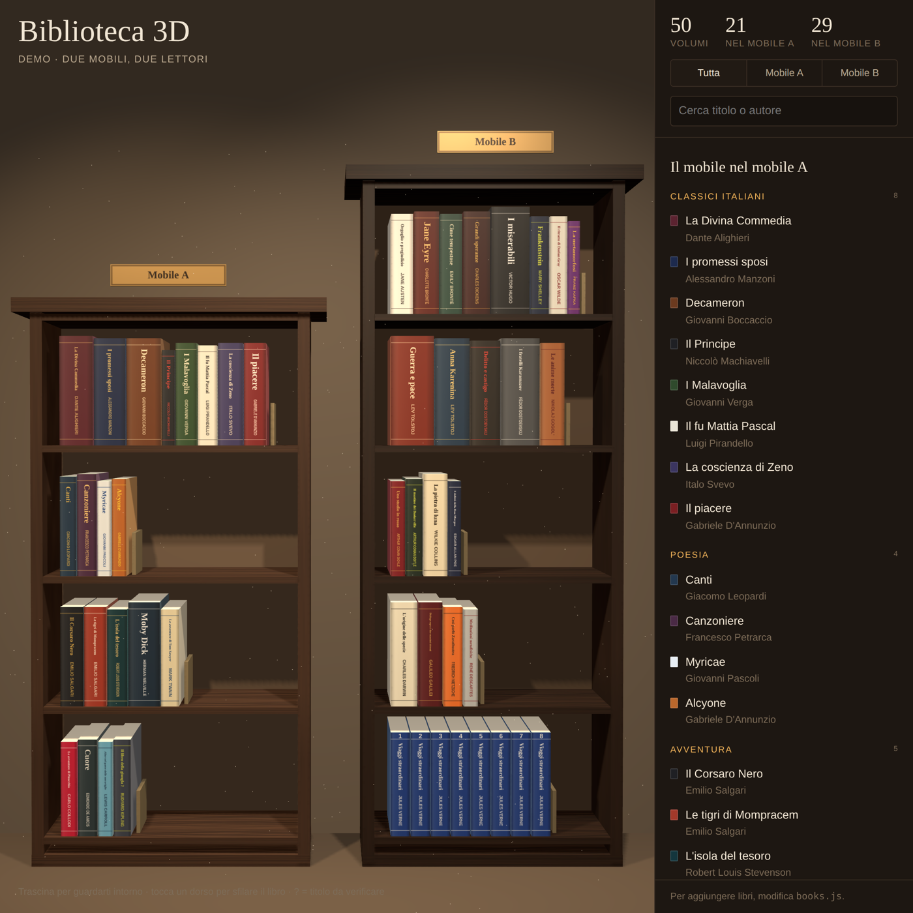

# 📚 Biblioteca 3D

Una libreria di casa trasformata in un catalogo interattivo navigabile in 3D, direttamente nel browser.

> **Demo:** i libri in questo repository sono classici di pubblico dominio usati come esempio.
> La versione originale contiene il catalogo reale di due librerie di famiglia, che resta privato.

## ✨ Funzionalità

- Scena 3D con due mobili e libri a dimensione e colore personalizzati
- Navigazione con mouse o touch (rotazione, zoom, pan)
- Un tocco sul dorso sfila il libro dallo scaffale e apre la scheda
- Catalogo laterale con filtro per mobile e ricerca per titolo o autore
- Collane ed enciclopedie raggruppate in una sola riga
- Titoli incerti marcati con "?"
- Nessun backend e nessuna build: due file statici

## ⚙️ Pipeline originale

1. **Acquisizione:** foto e video degli scaffali da smartphone
2. **Riconoscimento:** estrazione di titoli e autori dai dorsi con un modello multimodale (Claude)
3. **Strutturazione:** un oggetto per volume in `books.js` (titolo, autore, mobile, ripiano, serie, colori)
4. **Rendering 3D:** scena WebGL con [Three.js](https://threejs.org/) r128 e OrbitControls
5. **Deploy:** pagina HTML statica, consultabile da browser e da mobile

## 🛠️ Stack

- Three.js / WebGL
- HTML, CSS e JavaScript vanilla
- Google Fonts (Gloock, Karla)
- Claude per la visione e la generazione del codice

## 🚀 Usarla con i propri libri

1. Clona il repository
2. Modifica `books.js`:
   - `LIBRARY`: titolo e sottotitolo
   - `OWNERS`: i nomi dei due mobili
   - `SHELVES`: i ripiani
   - `BOOKS`: un `B(ripiano, titolo, autore, {opzioni})` per ogni libro
3. Apri `index.html` nel browser, oppure pubblicalo con GitHub Pages

Opzioni di ogni libro:

| Campo | Significato |
|---|---|
| `ed` | editore |
| `n` | numero del volume |
| `c` / `tc` | colore del dorso / del testo |
| `w` / `h` | spessore / altezza |
| `note` | nota libera |
| `series: 1` | fa parte di una collana |
| `q: 1` | titolo da verificare |

## 📄 Licenza

MIT. Vedi [LICENSE](LICENSE).
